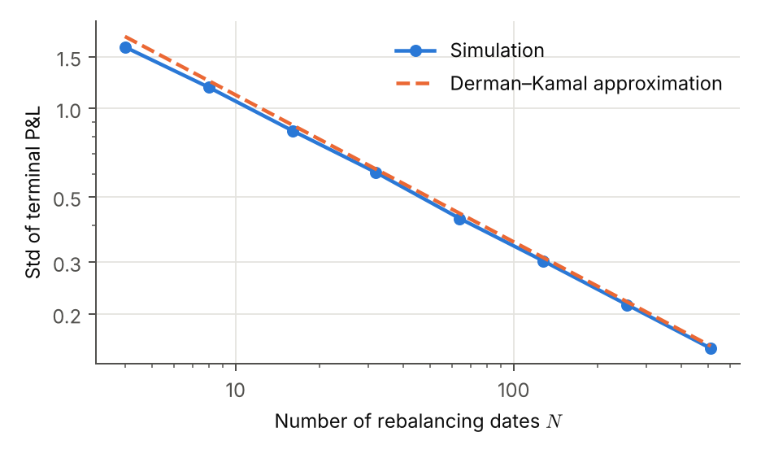
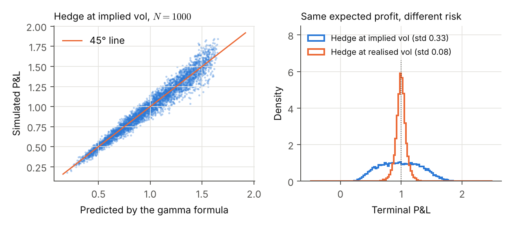
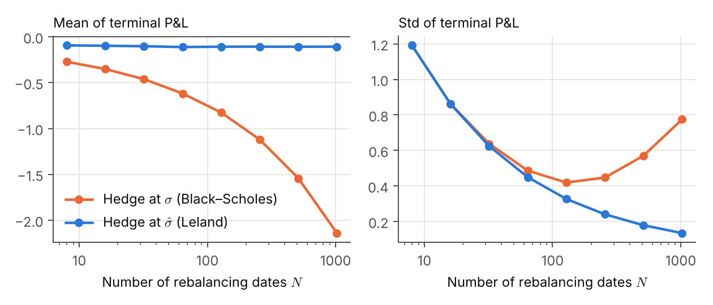

# Delta hedging in discrete time

Monte Carlo study of what remains of Black–Scholes replication when a short call is hedged

1. at finitely many dates,
2. with a volatility different from the one the stock actually exhibits, and
3. with proportional transaction costs.

A single second-order Taylor expansion of the option price over one rebalancing period explains all three effects; each prediction is checked against simulation. The derivations are heuristic and use only Taylor expansions and Gaussian moments; rigorous continuous-time versions are cited. The write-up is in [`paper/main.pdf`](paper/main.pdf).

## Main results

**Discrete rebalancing.** The hedging error decays like $N^{-1/2}$ in the number of rebalancing dates (fitted slope −0.49) and matches the Derman–Kamal approximation.



**Wrong volatility.** Hedging at the implied volatility $\Sigma$ while the stock realises $\sigma$ yields
P&L $= \frac{\Sigma^2 - \sigma^2}{2}\int_0^T e^{r(T-t)}\,\Gamma_t S_t^2\,dt$,
verified here path by path. Hedging at the realised volatility instead locks in a deterministic profit.



**Transaction costs.** Expected costs grow like $N^{1/2}$, so there is an optimal rebalancing frequency. Leland's adjusted volatility, which is a deliberate volatility misspecification, removes almost all of the cost bias.



## Repository layout

```
src/hedging/              Black–Scholes formulas and the hedging simulator
experiments/run_experiments.py   produces every figure and every number in the paper
tests/                    unit tests (Greeks vs finite differences, replication limits)
figures/                  generated figures (PDF for the paper, PNG for this page)
paper/                    LaTeX source; numbers.tex is generated by the experiments
```

## Reproducing

```bash
pip install -r requirements.txt
python -m pytest                       # about 2 seconds
python experiments/run_experiments.py  # about 25 seconds; writes figures/ and paper/numbers.tex
cd paper && latexmk -pdf main.tex
```

## References

- F. Black and M. Scholes, *The pricing of options and corporate liabilities*, Journal of Political Economy, 1973.
- H. M. Soner, S. E. Shreve and J. Cvitanić, *There is no nontrivial hedging portfolio for option pricing with transaction costs*, Annals of Applied Probability, 1995.
- H. Leland, *Option pricing and replication with transactions costs*, Journal of Finance, 1985.
- E. Derman and M. Kamal, *When you cannot hedge continuously: the corrections to Black–Scholes*, Risk, 1999.
